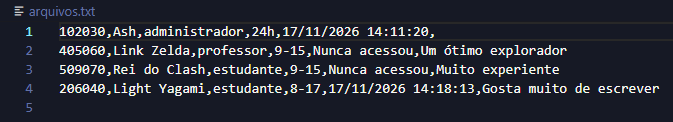

# Sistema de sentinelaLog

### Nosso projeto foi criado a fim de simular um sistema de segurança. Utilizamos um cenário de um ADM que consegue acessar dados de uma escola, também tem os perfis de professor e estudante dentro do código.

### Ao rodar o código pela primeira vez deve-se criar um login para o ADM, a matrícula do ADM, por ser algo sério, não será possível ser consultada, o usuário(ADM) deve manter o seu acesso com ele

### O login inicial (Quando não tem um ADM já existente) tem:
- Nome do ADM
- Matrícula do ADM

### Com ADM já existente:
- Login
- Sair

### dentre as opçõe que podem ser acessadas pelo ADM estão :

- Registrar usuário
- Visualizar usuário
- Atualizar usuário
- Deletar usuário
- Revelar matrícula
- Criar relatório
- Bloquear máquina
- Desbloquear máquina
- Sair

### Entendemos que o ADM está em uma posição de controle e manipulação de arquivos e dados, mas, o unico dado que não será possível alterar é a matrícula do usuário.
### A matrícula é a a chave do nosso dicionário, todos os outros dados presentes no código (nome, horário de acesso etc...) estão sendo relacionados a matrícula. Por isso não colocamos a opção do ADM alterar uma matrícula e sim, os dados que estão atrelados a ela

### O perfil do professor e do aluno tera:

- Visualizar seu usuário
- Atualizar seu usuário
- Sair

### Os dados são salvos em 3 arquivos, cada arquivo contem uma parte das informações que separamos para que o ADM possa analizar da forma em que ele achar melhor.

## Os arquivos são : 

## Acessos.txt 
### Nessa área colocamos informações como a matrícula, horário de acesso, computador em que a tentativa de login foi feita e o sucesso/falha dessa tentativa

## Arquivos.txt 
### Nessa área colocamos os seguintes dados :
### Matrícula, Nome, Perfil, Horário de acesso permitido, ultimo acesso do usuário e alguma observação(opicional).

## Relatório
### Nessa área colocamos os seguintes dados :
### Matrícula, Nome, Perfil, Acesso, Máquinas, Status, Observações e Motivo(Status)

